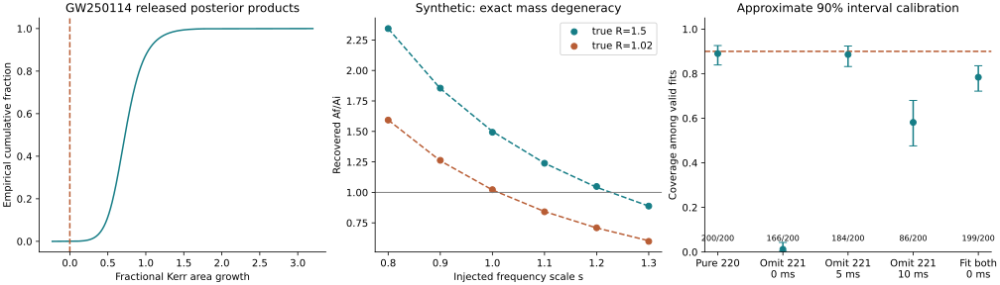

# Black-hole horizon areas under model mismatch

**EFMW-BH-AREA-003 · 31 October 2026**  
Prepared for Matthew Chenoweth Wright / Monolithic LLC with AI assistance. Research methods report; not peer reviewed.

## Result

We completed a bounded study with three components: reproduction of publicly released GW250114 area products; 3,200 synthetic ringdown injection/recovery trials; and a conditional stationary-entropy mapping for the scalar-curvature restriction of EFMW candidate C1.

The published reference area statistic is reproduced: **4.447211293**, rounding to **4.4σ**. The empirical product of the reference premerger and pooled ringdown samples gives **72.66% median area growth**, with a **41.49%–115.95% equal-tail 90% interval**, conditional on the original Kerr inference. These computations do not independently refit detector strain.

The synthetic experiment demonstrates a specific failure of identification: a constant-quality-factor shift of one damped mode is exactly absorbable into a different Kerr mass. At an injected frequency scale of 1.3, a stipulated true area ratio of 1.5 is recovered with median ratio **0.8875**. **122/200** trials have an approximate 90% interval wholly below unity despite stipulated true growth. These are constructed waveform stress tests, not self-consistent modified-gravity mergers or evidence that this happened in GW250114.

The inference procedure also fails a calibration check: the correctly specified two-mode model covers the true ratio in only **156/199 valid trials (78.39%)**, below the intended 90%. That failure is preserved. An EFMW-specific physical constraint remains **UNRESOLVED**.

## 1. Frozen scope and primary sources

The [protocol](PROTOCOL.md) and its SHA-256 lock were written before numerical outcomes. This is the third test path following kSZ/nonlinear averaging and extra GW polarizations. The target is inference robustness, not a claim that EFMW has supplied a new black-hole metric.

The principal observational source is the LVK paper *GW250114: Testing Hawking’s Area Law and the Kerr Nature of Black Holes*, **Physical Review Letters 135, 111403**, published **10 September 2025**, [doi:10.1103/kw5g-d732](https://doi.org/10.1103/kw5g-d732). It is peer reviewed. Its [version-of-record PDF](https://dcc.ligo.org/public/0201/P2500421/010/GW250114.pdf) and [data release v1](https://doi.org/10.5281/zenodo.16877102), also dated 10 September 2025, were inspected. This is older data used for a new reproducibility exercise, not a newly discovered event.

The data archive is 113,795,240 bytes, verified against the release MD5 `58c00488e66bc87d588b642cbdf33e2d`. [The manifest](sources/data-manifest.json) records SHA-256 and extracted-member hashes. `data/area_inputs.npz` is a lossless compact selection of the arrays used here; its provenance and rights are in [DATA_PROVENANCE.md](DATA_PROVENANCE.md).

Kerr quasinormal-mode approximations come from E. Berti, V. Cardoso and C. M. Will, **Physical Review D 73, 064030**, published **24 March 2006**, [doi:10.1103/PhysRevD.73.064030](https://doi.org/10.1103/PhysRevD.73.064030), Table VIII. This peer-reviewed fit is an established approximation, not a new EFMW equation.

## 2. Observational reproduction

For a neutral Kerr black hole,

\[
A(M,\chi)=8\pi(GM/c^2)^2[1+\sqrt{1-\chi^2}],\qquad
R=\frac{A_f}{A_1+A_2}.
\]

The independent premerger cut is -40 total-mass times relative to the peak; the fundamental-mode ringdown reference starts at 10.5 remnant-mass times. We follow the released numerical-macro script, including its random seed 250114, to select 2,000 samples without replacement from each of RINGDOWN and PYRING. The 4,000 pooled samples are compared with 8,175 premerger samples. Equal weighting of two inference implementations does not make them independent observations: both use the same event.

The published mean/variance statistic is

\[
Z_G=\frac{\langle A_f\rangle-\langle A_i\rangle}
{\sqrt{\operatorname{Var}(A_f)+\operatorname{Var}(A_i)}}.
\]

Our independent implementation and the isolated upstream statistic function agree exactly on the same inputs. The released ringdown masses and spins reproduce their accompanying Kerr areas to maximum relative error **6.66×10⁻¹⁶**.

| Reference calculation | Reproduced result |
|---|---:|
| Pooled Gaussian summary | 4.447211293 |
| RINGDOWN only | 4.312877098 |
| PYRING only | 4.697381393 |
| RINGDOWN 220+221, start 6 remnant-mass times | 3.633389138 |
| Median initial area, detector frame | 281,992.85 km² |
| Median final area, detector frame | 485,124.10 km² |
| Median Af/Ai | 1.726590 |
| Equal-tail 90% interval for Af/Ai | [1.414863, 2.159497] |

The ratio quantiles use **all 32,700,000 pairwise combinations**, not a quotient of marginal medians. Marginal redshifted areas are reported in km²; the common cosmological-redshift factor cancels from R. We use equal-tail intervals; these are not a reproduction of the paper's highest-posterior-density plotting convention.

There are 2,831 negative-growth pairs, giving an empirical positive fraction **0.9999134251**. The pairs reuse finite posterior samples and are not millions of independent observations. No binomial uncertainty is attached to this count, no claim of zero tail probability is made, and the Gaussian summary is not identified with this empirical tail fraction. Its 4.4σ notation describes a mean/variance approximation.

All 16 released premerger cuts are retained. Their Gaussian summaries range from **3.3585** at -250 total-mass times to **5.1765** at -5; the earliest cut reaching 5 is -10. The full scan and both ringdown-model start-time scans are in [observational.json](results/observational.json). These are correlated robustness comparisons, not independent trials or a significance enhancement.

**Limits:** original waveform assumptions, priors, calibration treatment and any posterior correlations remain inherited. The source compares separated inspiral and ringdown regimes; a full inspiral–merger–ringdown prediction would build in the GR merger relation and cannot substitute for this independent comparison. We performed no new strain likelihood, detector-noise analysis, numerical relativity or astrophysical parameter estimation. We did not alter the collaboration's conclusions.

## 3. Synthetic waveform experiment

The baseline is a single whitened channel with independent unit Gaussian noise sampled at 4,096 Hz for 80 ms. The stipulated remnant has detector-frame mass 68 M☉ and spin 0.68. Its fitted 220 frequency is 250.2585 Hz and damping time 4.0766 ms. The initial fundamental SNR is 30. An independent log-initial-area measurement has Gaussian standard deviation 0.03. There are two specified area ratios, 1.5 and 1.02; neither is imposed as a recovery constraint.

The simulated strain is a linear combination of damped cosine and sine quadratures. Nonlinear least squares fits frequency and damping time, or shared mass and spin for two modes, while profiling out the quadrature amplitudes. Three fixed initial guesses are used for every fit. Full-Jacobian local covariance is propagated into log area and combined with the independent initial-area uncertainty. The resulting 90% intervals are approximate frequentist intervals, not Bayesian posteriors.

For the fundamental fit,

\[
2\pi fM_t=1.5251-1.1568(1-\chi)^{0.1292},\quad
Q=\pi f\tau=0.7+1.4187(1-\chi)^{-0.4990},\quad
M_t=GM/c^3.
\]

Under the stipulated deformation f→sf, τ→τ/s, Q remains unchanged. Therefore χ is unchanged, M→M/s and A→A/s². This is an analytic degeneracy within the waveform family, not an optimizer defect. At true R=1.5, the noiseless inferred sign flips when s>√1.5≈1.224745. At R=1.02 it flips above √1.02≈1.009950.

| Stipulated true R | Frequency scale s | Median inferred R | Significant inferred decreases / 200 |
|---:|---:|---:|---:|
| 1.50 | 0.8 | 2.3437 | 0 |
| 1.50 | 0.9 | 1.8552 | 0 |
| 1.50 | 1.0 | 1.4931 | 0 |
| 1.50 | 1.1 | 1.2389 | 0 |
| 1.50 | 1.2 | 1.0484 | 1 |
| 1.50 | 1.3 | 0.8875 | 122 |
| 1.02 | 0.8 | 1.5931 | 0 |
| 1.02 | 0.9 | 1.2629 | 0 |
| 1.02 | 1.0 | 1.0222 | 4 |
| 1.02 | 1.1 | 0.8408 | 182 |
| 1.02 | 1.2 | 0.7095 | 200 |
| 1.02 | 1.3 | 0.5982 | 200 |

“Significant decrease” means the upper endpoint of the approximate central 90% interval is below R=1. All 2,400 frequency-scale fits are valid. At R=1.5, s=1.3, the rate is 61.0%; its Wilson 95% Monte Carlo interval is provided in the JSON. These rates characterize this artificial design only. The true area assignments are external to the deformed waveform: no consistent field equation, horizon metric or merger evolution has been claimed for it.

The effect works in the other direction too: s<1 raises the inferred area. More generally any stipulated ratio R can change its inferred sign through the factor s⁻². The unchanged residual fit cannot identify a scale deformation that is mathematically identical to a mass change. Independent observables or a theory-predicted relationship between modes and source parameters are necessary.

### Overtone controls and a failed calibration check

The contamination arm adds the conventional 221 mode at unit relative initial amplitude and phase 1 radian. These are chosen synthetic excitation parameters. They are not measured for GW250114. Later cuts retain the same injected amplitude rather than restoring the SNR.

| Recovery | Start | Retained SNR | Valid / 200 | Median inferred R | 90% coverage among valid fits |
|---|---:|---:|---:|---:|---:|
| Pure 220 control | 0 ms | 30.00 | 200 | 1.4931 | 178/200 = 89.0% |
| Omit injected 221 | 0 ms | 38.58 | 166 | 1.0962 | 2/166 = 1.2% |
| Omit injected 221 | 5 ms | 8.43 | 184 | 1.5419 | 163/184 = 88.6% |
| Omit injected 221 | 10 ms | 2.57 | 86 | 1.7474 | 50/86 = 58.1% |
| Fit both 220+221 | 0 ms | 38.58 | 199 | 1.4837 | 156/199 = 78.4% |

The pure-mode controls pass the frozen coverage diagnostic: their Wilson 95% intervals include 90%. The two-mode interval does not: **[72.16%, 83.54%]**, a **FAIL**. Adding the correct mode improves median recovery but does not repair the local Gaussian uncertainty approximation. A posterior or profile-likelihood treatment with repeated coverage checks is needed before these intervals could be used for scientific parameter claims.

Invalid fits are retained in the raw trial file, not converted into successful recoveries. They include out-of-range inverse spins, boundary solutions and covariance failures. Conditioning on validity is especially severe at 10 ms, where only 86/200 trials remain. That row cannot support a reliable measurement claim. A later cut trades contamination for information loss; it is not automatically safer.

The QNM fitting formulas themselves have finite approximation errors. Injection and recovery use the same approximation, so this experiment does not measure that modeling error. It also omits colored/nonstationary detector noise, sky and polarization geometry, calibration uncertainty, onset uncertainty, realistic source-mode excitation, full inspiral correlations and selection effects.

## 4. Area-mapping sensitivity and EFMW

Let eta multiply the inferred ratio without refitting the original likelihood. In this explicitly conditional sweep, corrected growth is eta*R−1. For the reference released samples:

- The median crosses zero at **eta=0.579176**.
- The lower endpoint of the central 90% interval crosses zero at **eta=0.706782**.
- The upper endpoint crosses zero at **eta=0.463071**.

These are sensitivity thresholds, **not bounds on eta**. A consistent alternative theory may change the waveform, geometry, priors and likelihood simultaneously; Kerr posterior post-processing does not perform that inference.

There is a specific conditional connection to C1. In its scalar-only, curvature-linear restriction, the coefficient of R can be written M_Pl²F/2 with F=1−2U_R/M_Pl². Applying the established stationary Wald formula gives

\[
S_W=\frac{1}{4G}\int_H F\,dA,\qquad
\frac{S_f}{S_1+S_2}=\frac{\bar F_f}{\bar F_i}\frac{A_f}{A_1+A_2}.
\]

The bars denote area-weighted horizon averages, with the initial average weighted across both progenitors. The same constant F on all horizons cancels. The derivation, units, positivity requirement and restrictions appear in [EFMW_MAPPING.md](EFMW_MAPPING.md). This uses Wald's established stationary result; it proves no dynamical second law for C1 and establishes no EFMW black-hole solution. The frequency scale s has **not** been mapped to F, eta or a C1 coupling.

## 5. Audit and evidence status

| Operation | Criterion | Result and status |
|---|---|---|
| Archive provenance | Published MD5 matches; member SHA-256 recorded | PASS; demonstrated |
| Kerr formula and QNM checks | Frozen analytic and numerical tolerances | 14/14 unit tests PASS; demonstrated within fit model |
| Public reference statistic | Within 0.15 of published 4.4 | PASS; 4.447211293 |
| Constant-Q recovery | Noiseless area agrees with A/s² within 10⁻⁵ | PASS; expected known degeneracy |
| Pure-mode interval calibration | Wilson95 includes nominal 0.90 | PASS for both undeformed controls |
| Correct two-mode interval calibration | Same diagnostic | FAIL; 156/199 coverage |
| EFMW waveform and physical inference | Derived solution, modes and likelihood mapping | UNRESOLVED |

These are ordinary named operations specified by this experiment, not invented Zoo-animal certifications. No full Zoo execution or Lean proof is claimed. Numerical checks establish bounded implementation properties, not physical validation.

The public result is a reproduction, not a novel detection. The mass degeneracy and entropy functional are established mathematics. The executed robustness matrix and its recorded failure rates are outputs of this particular benchmark. The strongest surviving methodological conclusion is that waveform fit quality, area sign and calibrated uncertainty are separate obligations.

## 6. Reproduction and next tests

See [README.md](README.md) for exact commands. The standalone [index.html](index.html) embeds all displayed results and runs without internet. It provides a noiseless explorer, a conditional posterior sweep, all 16 executed cases, recorded trial-0 waveforms, and JSON/CSV downloads. It does not rerun nonlinear inference in the browser.

The next three useful tests are:

1. **Repair uncertainty calibration:** replace the two-mode local Gaussian intervals with a profile likelihood or sampled posterior. Freeze the change and run new seeds. Require the Wilson95 interval for measured 90% coverage to include 0.90, while separately reporting invalid fits; failure remains a calibration failure.
2. **Add observational realism:** inject independently generated numerical/QNM waveforms into off-source H1/L1 data, vary onset and noise model, and evaluate recovery with two or more resolvable modes. Preserve the same false-area-decrease and coverage outputs rather than optimizing for a preferred sign.
3. **Supply a C1 branch:** freeze potential, couplings and asymptotic vacuum, solve for regular black holes, compute F on their horizons and derive their perturbation spectrum. A constant-scalar Kerr branch with no distinct observable is a valid negative outcome. Only a distinguishable, stable branch can advance to an EFMW-specific waveform test.

## Execution notes

An initial serialization error occurred after the first synthetic run because a NumPy integer was passed to JSON. The serialization was corrected and the same frozen design and seed rerun; the initial log is retained. One unit assertion was changed from exact floating-point equality to the protocol's 10⁻¹² tolerance after 1.4999999999999998 was compared with 1.5. Neither repair changed the science model, thresholds or injection selection. Scientific calibration failures were not repaired or hidden.
