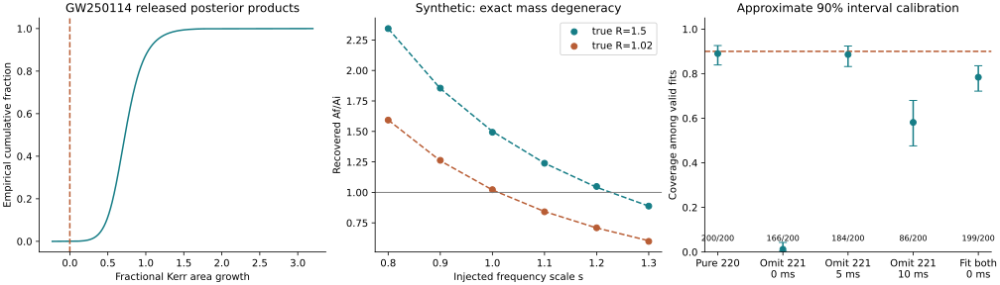

# Black Hole Horizon

[Open the black hole collision lab](https://enuminous.github.io/Black-Hole-Horizon/) to play the binary merger or explore EFMW scalar scattering. The repository's [index.html](index.html) includes the code and numerical data for both views and opens offline. [Collision methods and replay](collision/README.md).

The [horizon-area study](https://enuminous.github.io/Black-Hole-Horizon/area.html) reproduces the GW250114 area comparison, tests its robustness on synthetic data, and examines the conditional C1 entropy mapping. Open [area.html](area.html) for its offline explorer.

## Findings

- Reproduced GW250114's reference Gaussian area statistic: **4.4472**, rounding to the published **4.4σ**.
- Released Kerr-conditioned samples yield **72.7%** median area growth, equal-tail 90% interval **41.5%–115.9%**. This is a posterior-product reproduction, not a new strain analysis.
- Executed **3,200 synthetic trials**. A constant-Q frequency shift can be absorbed into an incorrect Kerr mass and area; an omitted overtone also biases recovery.
- Preserved a **failed uncertainty-calibration check**: the correct two-mode fit covers truth in **156/199 valid trials**, rather than the intended 90%.
- Derived a conditional stationary Wald-entropy expression for a scalar-only C1 restriction. **No EFMW-specific waveform, physical detection or observational coupling bound is established.**

[Full findings](FINDINGS.md) · [Frozen protocol](PROTOCOL.md) · [EFMW mapping](EFMW_MAPPING.md) · [Data provenance](DATA_PROVENANCE.md) · [Verification](results/gates.json)



## Reproduce

Python 3.12 was used. Create a virtual environment and install the pinned dependencies:

```sh
python3 -m venv .venv
source .venv/bin/activate
pip install -r requirements.txt
```

Verify cached observational products and numerical identities without network access:

```sh
python verify_results.py
```

Re-run all synthetic injections, then rebuild the lab and figure:

```sh
OPENBLAS_NUM_THREADS=1 python run_synthetic.py
python verify_results.py
python build_lab.py
node tests/check_lab.cjs
```

The 3,200 trials took about 38 seconds on the authoring runtime. Runtime varies. Seeds are fixed; numerical optimizers may show small differences across numerical-library/platform versions. Inspect all rate, validity and calibration outputs rather than assuming byte-identical results across environments.

For a fresh download and reproduction from the original LVK HDF5/NumPy files:

```sh
python fetch_data.py
python run_observational.py
python verify_results.py
python build_lab.py
```

The archive is approximately 114 MB. The downloader checks the pinned MD5, records SHA-256 hashes and extracts a limited set of regular files. It does not execute downloaded scripts. The analysis separately evaluates the one released mean/variance function after selecting its definition with Python AST. All other upstream scripts are provenance references only.

`verify_results.py` exits unsuccessfully for software/integrity failures. A scientific calibration FAIL is written to the result ledger and remains visible; it is not disguised as a software exception or changed to PASS. See the coverage criterion in the frozen protocol.

## Repository contents

- `model.py`, `run_synthetic.py`: ringdown approximation, estimator and full experiment.
- `run_observational.py`, `fetch_data.py`: public data acquisition and original-product reproduction.
- `data/area_inputs.npz`: lossless, attributed subset of original arrays for offline verification.
- `results/injection_trials.csv`: every trial, including invalid fits.
- `results/observational.json`: reference reproduction, all premerger cuts, ringdown scans and mapping sensitivity.
- `results/synthetic.json`: all 16 cases and Wilson 95% rate intervals.
- `results/waveform_examples.json`: trial 0 of each case; no selection by appearance.
- `lab.template.html`, `build_lab.py`: source and deterministic assembly of the two standalone pages.
- `tests/`: numerical identities, noiseless recovery, and Python/JavaScript cross-checks.

## Publication and scope

The [area study](https://enuminous.github.io/Black-Hole-Horizon/area.html) and [collision simulator](https://enuminous.github.io/Black-Hole-Horizon/) run on GitHub Pages and work from an extracted repository download.

This is a bounded completed methods study, not a complete test of EFMW as a physical theory. No fresh detector search, general area-theorem proof, numerical-relativity merger, full Zoo audit or Lean verification is reported. Prepared for Matthew Chenoweth Wright / Monolithic LLC with AI assistance, 31 October 2026.

Original observational data remain attributed to the LIGO Scientific, Virgo and KAGRA Collaborations, CC BY 4.0. See [LICENSE_NOTICE.md](LICENSE_NOTICE.md).
